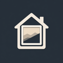

<p align="center">
  
</p>

# Home Assistant Add-on: Frame14

[![Version][version-shield]][releases]
[![Build][build-shield]][build]
[![Tests][tests-shield]][tests]
[![Release][publish-shield]][publish]
![Project Maintenance][maintenance-shield]
[![Home Assistant Add-on][addon-shield]][repository]

![Supports aarch64 Architecture][aarch64-shield]
![Supports amd64 Architecture][amd64-shield]
![Supports armhf Architecture][armhf-shield]
![Supports armv7 Architecture][armv7-shield]

A home dashboard for a tablet on the wall — clock, weather, photos, lights, climate and energy at a glance — with your phone as its remote.

[![Add repository on my Home Assistant][repository-badge]][repository]

## About

Frame14 turns a wall-mounted tablet into the house's display and a phone into its remote. It runs as a Home Assistant add-on and follows Home Assistant's WebSocket API, so everything on screen is live.

- **Home** — weather, thermostats, energy, the calendar, fans, the 3D printer and the robot vacuums as cards you can rearrange, resize and hide per device (press and hold).
- **Clock and Photos** — an analog or digital clock, and an Immich album as a slideshow; a remote picks the photo the frames show.
- **Lights and Climate** — lights and switches grouped by room; thermostats with a dial, mode and fan controls.
- **Energy** — the power flow now, today's solar curve, month and year history, and the draw per circuit.
- **Weather** — conditions and advisories, hourly and daily forecasts, the radar.
- **Printer, Vacuum, Cameras, Calendar** — a Bambu Lab printer with its camera and job, Roborock vacuums with their maps, every camera live, and a two-week agenda.
- **And more** — a Plex movie takes over the frames as its poster; a tracked team's game day gets a scoreboard; a doorbell card pops up when someone is at the door; the mic runs an Assist pipeline.
- **Frame or remote** — each device is a frame (the tablet) or a remote (a phone), with its own navigation; Home Assistant automations can switch the frames' view on motion. Installable as a PWA.

## Installation

1. Add this repository to your Home Assistant instance with the My button above, or by hand: **Settings → Add-ons → Add-on Store → ⋮ → Repositories**, and add

   ```
   https://github.com/thefreymaster/frame14
   ```

2. Open the add-on and click **Install**.

   [![Open this add-on in your Home Assistant instance.][addon-badge]][addon]

3. On the **Configuration** tab, fill in the options below — at least `ha_token`, the Immich server and `web_ui_url`.
4. Turn on **Start on boot** and **Watchdog**, then **Start** the add-on.
5. Open the dashboard at `http://<home-assistant>:4000` on the tablet and on your phone (**Open Web UI** and the sidebar entry go there too). A phone starts as a remote and a tablet as a frame; **Settings → Use as display / Use as remote** switches it.

## Configuration

Set in the add-on's **Configuration** tab (lists in YAML mode). Entity IDs are Home Assistant's.

### Connection

| Option | Description | Default |
|---|---|---|
| `ha_url` | Home Assistant's URL | `http://supervisor/core` |
| `ha_token` | A long-lived access token. An administrator's: the Software card's *Check for updates* asks the Supervisor to reload the store | |
| `port` | The port the dashboard listens on | `4000` |
| `web_ui_url` | Where **Open Web UI** and the sidebar entry send the browser — the add-on's address as your devices reach it, e.g. `http://192.168.1.10:4000`. Ingress only redirects there | |
| `screen_type` | `oled` or `lcd` | `oled` |

### Photos, media and voice

| Option | Description | Example |
|---|---|---|
| `immich_url` | Immich server URL | `http://192.168.1.20:2283` |
| `immich_api_key` | Immich API key | |
| `plex_url` | Optional: the Plex server, by its `plex.direct` hostname, for full-resolution marquee posters | |
| `plex_token` | Optional: the Plex token | |
| `media_player_entity` | The marquee's Plex player: its poster fills the frames while a movie plays | `media_player.plex_plex_for_apple_tv_apple_tv` |
| `media_player_entities` | The Media page's players (the page is switched off for now) | `- media_player.living_room_tv` |
| `assist_pipeline_id` | Optional: the Assist pipeline the mic runs; empty uses Home Assistant's preferred one | |
| `assist_speaker` | Optional: a `media_player` that also speaks the reply | |

### Weather

| Option | Description | Example |
|---|---|---|
| `weather_entity` | Current conditions | `weather.systems_weatherkit` |
| `weather_forecast_entity` | Hourly and daily forecasts | `weather.systems_weatherkit` |
| `weather_temperature_entity` | An outdoor temperature sensor with long-term statistics, for the solar history's daily readout | `sensor.weatherkit_temperature` |

### Lights, climate and fans

| Option | Description | Example |
|---|---|---|
| `light_entities` | Lights and switches to control | see below |
| `light_areas` | Rooms (Home Assistant areas, by name or id) whose lights are all included | see below |
| `climate_entities` | Thermostats | see below |
| `climate_names` | Optional labels for thermostats, by entity ID (otherwise the entity's name) | see below |
| `fan_entities` | Fans, on the Home page's Fans card | `- fan.living_room_ceiling_fan` |

### Energy

| Option | Description | Example |
|---|---|---|
| `energy_current_production` | Live solar production | `sensor.envoy_xxx_current_power_production` |
| `energy_current_consumption` | Live consumption | `sensor.envoy_xxx_current_power_consumption` |
| `energy_production_today` | Today's production total | `sensor.envoy_xxx_energy_production_today` |
| `energy_consumption_today` | Today's consumption total | `sensor.envoy_xxx_energy_consumption_today` |
| `energy_lifetime_production` | Optional: the lifetime production meter — today's total is taken from it, which is steadier than an inverter's own "today" sensor | `sensor.envoy_xxx_lifetime_energy_production` |
| `energy_lifetime_consumption` | Optional: the lifetime consumption meter | `sensor.envoy_xxx_lifetime_energy_consumption` |
| `circuit_main_entity` | The whole-house power sensor, for the Circuits tab | `sensor.vueenergymonitor_power_minute_average` |
| `circuit_balance_entity` | Optional: the unmonitored balance | `sensor.balance_power_minute_average` |
| `circuit_entities` | The circuits, a `name` and a `power` sensor each | see below |

### Devices and cameras

| Option | Description | Example |
|---|---|---|
| `vacuum_entities` | Robot vacuums (Roborock) | `- vacuum.roborock_q5_pro` |
| `printer_status_entity` | Optional: the 3D printer's status sensor — ha-bambulab's `sensor.xxx_print_status` or Bambuddy's `sensor.xxx_status`; the other printer sensors are derived from it | `sensor.a1_xxx_print_status` |
| `team_tracker_entities` | TeamTracker sensors; a tracked team's game day gets the scoreboard | `- sensor.teamtracker_fsu` |
| `person_entity` | Optional: a binary sensor whose `on` pops up the doorbell card | `binary_sensor.front_porch_person_detected` |
| `camera_entity` | The doorbell card's camera | `camera.front_porch_high` |
| `camera_entities` | The Cameras page's cameras; the doorbell's when empty | `- camera.front_porch_rtsp` |

### Examples

**`light_entities`:**

```yaml
- light.living_room
- light.kitchen_main_lights
- switch.sonoff_1001816bdb
- light.front_yard
```

**`light_areas`** (every light in these rooms is included, no need to list them; `light_entities` still adds lights and switches elsewhere):

```yaml
- Living Room
- Kitchen
- Outside
```

The Lights page groups the lights by room — the areas they (or their devices) are assigned to in Home Assistant, the listed rooms first in that order. A light in no area shows under "Other lights". Lights disabled or hidden in Home Assistant, and config or diagnostic entities such as a plug's indicator LED, are not imported from a room.

Light names and icons are derived from entity IDs — `light.kitchen_main_lights` becomes "Kitchen Main Lights" — until Home Assistant's own names arrive.

**`climate_entities`:**

```yaml
- climate.samsung_airconditioner_1
- climate.samsung_airconditioner_2
- climate.samsung_airconditioner_3rd_flr
```

**`climate_names`** (a thermostat without an entry shows its Home Assistant name):

```yaml
- entity: climate.samsung_airconditioner_1
  name: 1st Floor AC
- entity: climate.samsung_airconditioner_2
  name: 2nd Floor AC
```

**`circuit_entities`:**

```yaml
- name: Heat Pump 1
  power: sensor.ac1_power_minute_average
- name: Kitchen
  power: sensor.ac3_power_minute_average
```

## The pages

| Path | Description |
|---|---|
| `/` | Redirects to `/home` |
| `/home` | Overview: weather, climate, energy, calendar, printer, vacuum, fans; cards rearrange per device (press and hold) |
| `/clock` | Analog or digital clock (tap to switch); frame-only nav item |
| `/lights` | Light and switch controls, grouped by room |
| `/climate` | The thermostats: dial, mode and fan controls |
| `/energy` | Power flow now, with Solar (today, month and year history) and Circuits (per-circuit draw) as tabs; `/solar` and `/power` redirect here |
| `/printer` | The 3D printer: camera, job progress and controls, temperatures; off by default in a remote's nav |
| `/vacuum` | The robot vacuums: state, controls, map, wear parts; off by default in a remote's nav |
| `/cameras` | Every camera live (stills when the stream won't start), the printer's camera and the vacuum maps; off by default in a remote's nav |
| `/photos` | Immich photo slideshow; frame-only nav item |
| `/album` | A remote's Photos: the album as a grid, tap a photo to show it on the frames |
| `/weather` | Now (conditions + advisories from the forecast), with Hourly, Daily and Radar as tabs; `/radar` redirects to the Radar tab |
| `/calendar` | The next two weeks across every Home Assistant calendar, a card per day |
| `/media` | The media players: what is playing, transport, volume and source (switched off for now) |
| `/timer` | Timer; frame-only nav item |
| `/marquee` | Plex now-playing poster art; auto-routed while a movie plays |
| `/football` | Score bug + game detail for a tracked team; in the nav and auto-routed on game day |
| `/blank` | Black screen (motion off) |
| `/control` | Settings + remote control: device mode, this device's navigation, software updates |

## Home Assistant automation (motion)

`oled-dashboard/ha-automation.yaml` is a reference automation: it calls `GET /api/change/:view` to switch the frames' view when motion is detected or times out.

## Changelog & releases

Every version is on the [Releases][releases] page with its notes, and in the add-on's **Changelog** tab in Home Assistant ([CHANGELOG.md](oled-dashboard/CHANGELOG.md)). The Release workflow publishes a version the moment its bump lands on `main`; the add-on store picks it up on its next check, or at once from **Check for updates** on the dashboard's Software card.

## Local development

```bash
cd oled-dashboard
npm install
```

Copy `.env.example` to `.env` and fill in your values. `frame14.json` in `oled-dashboard/` holds the entity config outside the add-on (same fields as the options above, camel-cased):

```json
{
  "lights": ["light.living_room", "light.kitchen_main_lights"],
  "weather": {
    "current": "weather.systems_weatherkit",
    "forecast": "weather.systems_weatherkit"
  },
  "climate": ["climate.1st_floor_ac"],
  "energy": {
    "currentProduction": "sensor.envoy_xxx_current_power_production",
    "currentConsumption": "sensor.envoy_xxx_current_power_consumption",
    "productionToday": "sensor.envoy_xxx_energy_production_today",
    "consumptionToday": "sensor.envoy_xxx_energy_consumption_today"
  }
}
```

Run both processes:

```bash
npm run dev      # Vite dev server on :3000, proxies /api to :4000
node index.js    # Express server on :4000
```

Build for production:

```bash
npm run build
```

Swagger UI: `http://localhost:4000/api/docs`

### Tests

Unit tests run with [Vitest](https://vitest.dev) and the end-to-end tests with [Playwright](https://playwright.dev), against a stub Home Assistant that ships with the repository (`tests/stub/stub-ha.mjs`), so neither needs a real Home Assistant. Both run on every pull request and every push to `main`.

```bash
npm test                              # the unit tests: the client's libs and components, the server's routes and socket
npm run test:watch                    # the same, re-run as files change
npm run build && npm run test:e2e     # the end-to-end tests: the built app in a desktop and a phone browser
npx playwright install chromium       # once, for the browser the end-to-end tests drive
```

## Authors & contributors

The original setup of this repository is by [Evan Freymiller][thefreymaster].

[releases]: https://github.com/thefreymaster/frame14/releases
[version-shield]: https://img.shields.io/github/v/release/thefreymaster/frame14?label=version
[build]: https://github.com/thefreymaster/frame14/actions/workflows/build.yml
[build-shield]: https://img.shields.io/github/actions/workflow/status/thefreymaster/frame14/build.yml?branch=main&label=build
[tests]: https://github.com/thefreymaster/frame14/actions/workflows/test.yml
[tests-shield]: https://img.shields.io/github/actions/workflow/status/thefreymaster/frame14/test.yml?branch=main&label=tests
[publish]: https://github.com/thefreymaster/frame14/actions/workflows/release.yml
[publish-shield]: https://img.shields.io/github/actions/workflow/status/thefreymaster/frame14/release.yml?branch=main&label=release
[maintenance-shield]: https://img.shields.io/maintenance/yes/2026.svg
[addon-shield]: https://img.shields.io/badge/Home%20Assistant-add--on-41BDF5?logo=homeassistant&logoColor=white
[aarch64-shield]: https://img.shields.io/badge/aarch64-yes-green.svg
[amd64-shield]: https://img.shields.io/badge/amd64-yes-green.svg
[armhf-shield]: https://img.shields.io/badge/armhf-yes-green.svg
[armv7-shield]: https://img.shields.io/badge/armv7-yes-green.svg
[repository]: https://my.home-assistant.io/redirect/supervisor_add_addon_repository/?repository_url=https%3A%2F%2Fgithub.com%2Fthefreymaster%2Fframe14
[repository-badge]: https://my.home-assistant.io/badges/supervisor_add_addon_repository.svg
[addon]: https://my.home-assistant.io/redirect/supervisor_addon/?addon=a49505b0_frame14&repository_url=https%3A%2F%2Fgithub.com%2Fthefreymaster%2Fframe14
[addon-badge]: https://my.home-assistant.io/badges/supervisor_addon.svg
[thefreymaster]: https://github.com/thefreymaster
